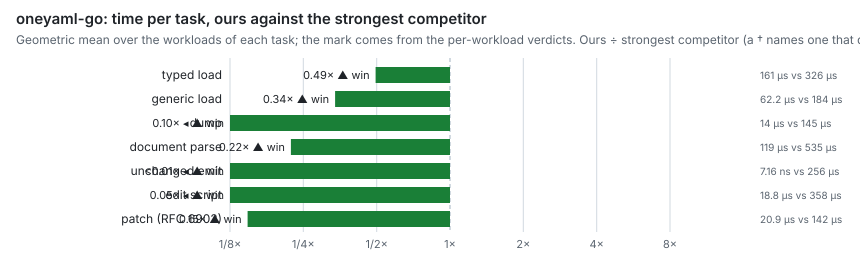

# oneyaml-go

**`encoding/json`-style YAML 1.2 and comment-preserving editing for Go, in
one package.** Edit a file or apply a JSON Patch to it and only what you
touch changes; load, dump, parse and edit faster, with less memory, than any
other Go YAML library we measured.

[](https://pkg.go.dev/oneyaml.dev/go)
[](https://github.com/recursive-ai-oss/oneyaml-go/actions/workflows/ci.yml)
[](docs/stability.md#go-versions)
[](#license)

How many times faster oneyaml-go is than the strongest Go competitor on each
task, on real-world files (higher is better):

<!-- generated:bench-chart -->
<picture>
  <source media="(prefers-color-scheme: dark)" srcset="docs/img/oneyaml-go-hero-dark.svg">
  
</picture>

[Full results, with memory and the method →](docs/performance.md)
<!-- end generated -->

## Why oneyaml

- **Edits that keep your file.** An unedited document writes back byte for
  byte. `Set`, `Remove`, `Rename` and the comment setters change only what
  you touch, each value in its own style, and comments stay where they were
  ([Editing](docs/editing.md)).
- **JSON Patch and merge patch on YAML.** RFC 6902 and RFC 7396 patches apply
  to a YAML file all or nothing, and keep its layout and comments
  ([Patches](docs/patches.md)).
- **YAML 1.2 by default.** `yes` is a string and `0755` is the integer 755.
  Checked against the full yaml-test-suite
  ([conformance](docs/conformance.md)).
- **The `encoding/json` API you know.** `Unmarshal`, `Marshal`, `NewDecoder`
  and `NewEncoder`, with struct tags. `json` tags and `UnmarshalJSON` methods
  work too, so Kubernetes API types load as they are.
- **Safe on untrusted input.** Depth, alias expansion and number size are
  bounded by default, and `Untrusted()` adds caps on input size for network
  input. No `unsafe`, no cgo, no dependencies outside the standard library
  ([Limits](docs/limits.md)).
- **Drop-in adapters for yaml.v3 and sigs.k8s.io/yaml.** Change one import
  and keep your call sites; the guides for
  [yaml.v3](docs/migrate-yaml-v3.md) and
  [sigs.k8s.io/yaml](docs/migrate-sigs-k8s-yaml.md) list what differs.

## Install

```sh
go get oneyaml.dev/go
```

## Quick start

Read a file into a struct, then edit it in place: the edit changes one value,
and the comments and every other byte stay.

<!-- example: Example_quickStart -->
```go
src := []byte(`# deploy settings
name: api
replicas: 2 # raised by the release job
`)
// Read into a struct, as with encoding/json.
var cfg struct {
	Name     string `yaml:"name"`
	Replicas int    `yaml:"replicas"`
}
if err := oneyaml.Unmarshal(src, &cfg); err != nil {
	log.Fatal(err)
}
fmt.Println(cfg.Name, cfg.Replicas)

// Edit in place: everything else, comments included, stays byte for byte.
doc, err := oneyaml.Parse(src)
if err != nil {
	log.Fatal(err)
}
if err := doc.Set("/replicas", cfg.Replicas+1); err != nil {
	log.Fatal(err)
}
fmt.Print(doc)
// Output:
// api 2
// # deploy settings
// name: api
// replicas: 3 # raised by the release job
```

The example imports `fmt`, `log` and `oneyaml "oneyaml.dev/go"`. Every
feature has a runnable example on [pkg.go.dev](https://pkg.go.dev/oneyaml.dev/go).
For input you don't control, pass [`Untrusted()`](docs/limits.md#untrusted-input).

## Where to go

- **API reference:** [pkg.go.dev](https://pkg.go.dev/oneyaml.dev/go).
- **Tasks:** [editing a file](docs/editing.md), [patches](docs/patches.md),
  [limits and untrusted input](docs/limits.md).
- **Moving from another library:** [yaml.v3](docs/migrate-yaml-v3.md),
  [sigs.k8s.io/yaml](docs/migrate-sigs-k8s-yaml.md).
- **Choosing a library:** [how oneyaml-go compares](docs/comparison.md),
  including where the others win.
- **Evidence:** [performance](docs/performance.md),
  [conformance](docs/conformance.md).
- **Releases:** [changelog](CHANGELOG.md), [stability and Go versions](docs/stability.md).
- **Contributing and security:** [CONTRIBUTING.md](CONTRIBUTING.md),
  [SECURITY.md](SECURITY.md), [CODE_OF_CONDUCT.md](CODE_OF_CONDUCT.md).
- **The oneyaml family:** [oneyaml-kit](https://github.com/recursive-ai-oss/oneyaml-kit),
  the shared conformance and benchmark kit, and
  [oneyaml for Rust](https://github.com/recursive-ai-oss/oneyaml-rust).

## License

Licensed under either of [Apache License, Version 2.0](LICENSE-APACHE) or
[MIT license](LICENSE-MIT) at your option.
